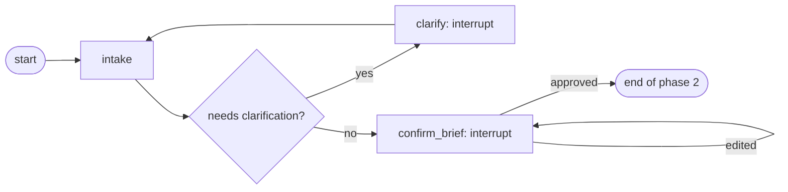
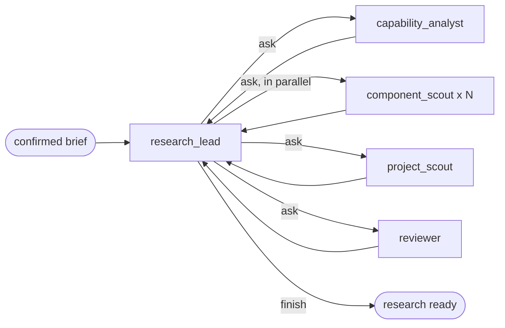
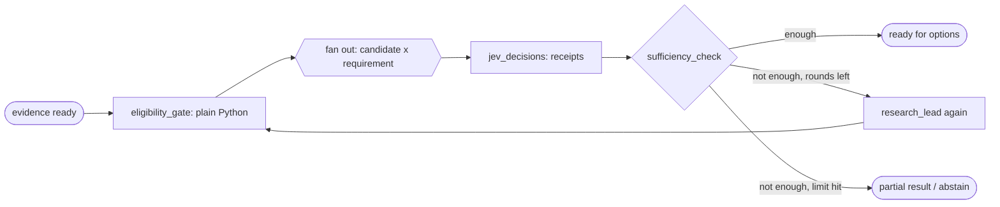
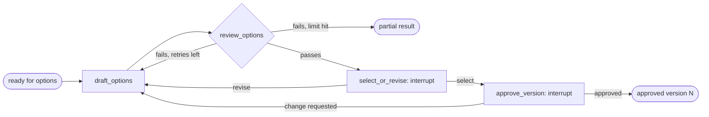
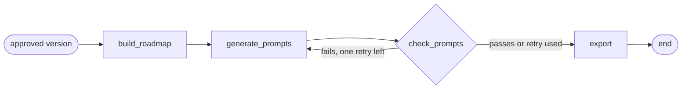

# Archway Development Plan (the LangGraph view)

This file answers one question: **in what order do we build Archway, and which LangGraph idea does each stage teach?**

It does not replace [IMPLEMENTATION_GUIDE.md](IMPLEMENTATION_GUIDE.md). That file stays the source of truth for *what* each phase must deliver and for the checkpoints that must pass. This file re-reads the same six phases through LangGraph: which graph exists at the end of each phase, which concepts it uses, and which lesson to read first.

Concepts are explained in [LEARNING_GUIDE.md](LEARNING_GUIDE.md). Lesson scripts are in [backend/learning/](backend/learning/).

**Status (2026-10-23):** **Phases 1 to 5 are built** and run live (494 backend tests): chat to a confirmed brief, the research team, decisions answered by Laya with the eligibility gate, and architecture options with a review gate, selection, revision and approval of one version. Also built since: a readiness gate before the brief (topic 63 of the learning guide), a voice relay for the voice agent (64), grounding of the brief (66), and the run recording what the agents are doing and which sources they used (67, 68). **Phase 6 is built too (2026-10-23)**: the build plan (roadmap, staged prompt pack checked against the rubric in plain code, source-to-decision links, zip/JSON/Markdown export, a Plan step in the studio) and a pipeline evaluation that runs every sample brief offline (507 backend tests, 130 frontend tests). **Still open for release:** one manual build trial with a coding agent, a live run of the pipeline evaluation, README screenshots and a demo recording, and a full keyboard and reduced-motion check. The phase sections below keep their original plans; their status lines say what was built.

---

## 1. The big picture

| Phase | Name | LangGraph at the end of the phase | Milestone |
|---|---|---|---|
| 1 | Contracts and skeleton (**done**) | **No graph yet.** Models, database, API, mock events | M1 |
| 2 | Chat to confirmed brief (**done**) | First real graph: `intake`, `clarify`, `confirm_brief`, with interrupts and a SQLite checkpointer | M1 |
| 3 | Research and evidence | Research stage added (a subgraph): plan, search, inspect, fetch, normalise | M2 |
| 4 | Eligibility and Jev | Judgment stage and the bounded research loop; honest abstention | M2 |
| 5 | Options and choice | Draft, review loop, two human interrupts, revisions as new versions | M3 |
| 6 | Roadmap and prompt pack (**built**, release items open) | Last stage, export, evaluation, release | M4 |

Two things worth noticing:

- **Phase 1 is not LangGraph.** It prepares the ground (the data shapes the graph will carry, the settings, the database). Starting the graph before the data contracts exist would mean rewriting nodes later.
- **The graph grows by adding stages, not by rewriting.** Each phase adds nodes at the end of the previous graph. If a phase forces you to rewrite an earlier stage, the earlier stage was not modular enough.

---

## 2. The recipe for adding any node or stage

Use the same eight steps every time. It is slow once and fast forever, and it is what keeps the code beginner-friendly.

1. **Write the state keys first.** Add the keys the new node reads and writes to the state, and decide for each: replace or append (a reducer, see Lesson 02).
2. **Write the node as a plain function** in its own file. It takes the state and returns only the keys it changes (Lesson 01).
3. **Put anything external behind an adapter** (model, GitHub, Jev). The node receives the adapter; it never builds one (Lesson 20).
4. **Write a fixture version of the adapter** so the node runs offline.
5. **Test the node on its own**, then wire it into the graph and test the graph's routes with fixtures (Lesson 22 test file).
6. **Add the limit and the honest exit.** Every loop gets a counter, a cap, and an abstain or partial path (Lessons 03, 14, 18).
7. **Emit real progress events** from inside the node, only for work that actually happened (Lesson 06).
8. **Only then connect the live service**, behind the mode switch. Record usage and keep the LIVE/FIXTURE label truthful.

Add a lesson or extend the learning guide in the same piece of work (standing rule).

---

## 3. Planned file layout for the graph

One file per node, so each can be read, swapped, or removed alone. Phases 1 to 3 are built; the rest is **planned**. Since Phase 3, work that needs judgement is done by **agents** (`backend/app/agents/`, one file each) using **tools** (`backend/app/tools/`); outside services live in `backend/app/integrations/` and evidence records in `backend/app/evidence/`.

```text
backend/app/graph/
  state.py             # the shared State and its reducers
  build.py             # assembles the graph from the node files
  routers.py           # small pure functions that choose a route
  nodes/
    intake.py              # LLM: draft brief and open questions
    clarify.py             # interrupt: ask the user
    confirm_brief.py       # interrupt: approve the brief version
    (research is a team of agents, wired in by research_team.py; see Phase 3)
    eligibility_gate.py    # Python: policy, no model
    jev_decisions.py       # Jev: one question per candidate and requirement
    sufficiency_check.py   # Python: loop, proceed, or abstain
    draft_options.py       # LLM: one to three options
    review_options.py      # LLM and Python: citation and constraint checks
    select_or_revise.py    # interrupt: select or ask for changes
    approve_version.py     # interrupt: approve one specific version
    build_roadmap.py       # LLM: task graph and decision records (built)
    generate_prompts.py    # Python: prompt pack from the template (built)
    check_prompts.py       # Python: rubric, one retry (built)
    export.py              # Python: links and JSON; Markdown and zip on download (built)
```

---

## Phase 1: Contracts, skeleton, shell

**Goal.** Everything the graph will need, with no graph.

**LangGraph concepts used:** none directly. The Pydantic models become the *values* inside the state later.

| Build | Learn first |
|---|---|
| Pydantic models for every record in the guide's Section 4 | Lesson 08 |
| Settings: `jev_mode`, `llm_mode`, `github_mode`, required call caps | Lesson 20 |
| SQLite schema, projects, messages, runs | Lesson 11 |
| FastAPI app, health check, SSE endpoint with mock events | Lessons 10, 09 |
| Sample brief fixtures (6 to 8) | Lesson 08 |

**Why it comes first.** The state of the graph is built from these models, and every node needs the mode switch and the caps from the first call.

**Done when:** Checkpoint 1 in the implementation guide passes.

**Result: done on 2026-10-13.** What exists:

| Part | Where |
|---|---|
| Settings, modes, secrets | `backend/app/config/`, `backend/.env`, `backend/.env.example` |
| Data contracts and run lifecycle | `backend/app/models/` |
| SQLite, migrations, repositories | `backend/app/db/` |
| API, demo event stream | `backend/app/api/`, `backend/app/events/`, `backend/app/main.py`, `backend/run.py` |
| Sample briefs (7) | `backend/fixtures/briefs/`, `backend/app/samples/` |
| Structured logging | `backend/app/logging_setup.py` |
| Tests (92) | `backend/tests/` |
| Studio shell with mode badge | `frontend/src/views/StudioPage.tsx`, `frontend/src/components/studio/` |
| License review of dependencies | `docs/dependency-licenses.md` |

To run it, start the backend with `backend/.venv/bin/python backend/run.py` and the frontend with `npm --prefix frontend run dev`, then open `http://localhost:5173/#/studio`.

---

## Phase 2: Chat to a confirmed, versioned brief

**Goal.** The first real graph. A user's idea becomes a brief they confirmed, and the run survives a restart.



**LangGraph concepts introduced:** state and reducers, nodes and edges, conditional edges, **interrupts**, **checkpointer and threads**, the async API, streaming, run context for the LLM call cap.

| Build | Learn first |
|---|---|
| State with `messages`, `brief`, `open_questions`, counters | Lessons 01, 02 |
| `intake` node behind an LLM adapter (fixture first) | Lesson 20, topic 23 in the guide |
| `clarify` and `confirm_brief` interrupts | Lessons 05, 17 |
| Async graph with `AsyncSqliteSaver` | Lessons 04, 12 |
| LLM call counter and per-run cap | Lesson 18 |
| Graph events to the SSE endpoint, workflow view lights up | Lessons 06, 10 |
| Decide stream API: `stream(version="v2")` or `stream_events` (v3, experimental) | Lessons 06, 19 |

**Decisions to record in this phase:** whether application tables and checkpoints share one SQLite file; v2 or v3 streaming; which LLM provider.

**Teaching moment.** Resuming re-runs the interrupted node from its first line. Anything placed before `interrupt()` must be safe to repeat.

**AI suggestions on the draft brief (added 2026-10-14).** The confirm step now opens as an editable draft. Beside Must have, Constraints, Assumptions and each open question, the model offers up to 5 suggestions, shown as "AI suggestion" panels. They are not a graph node: the run is already paused, so a small service (`backend/app/workflow/suggestions_service.py`) makes one model call per brief version, saves the result, and counts it against the run's call cap. Code bounds and cleans the reply (`backend/app/briefing/suggestions.py`): at most 5 per block, nothing the brief already says, no invented figures in constraints, answers only for questions that really exist. A suggestion joins the brief only when the user adds it.

**Fixed after review (2026-10-14).** Typing only "hi" used to get three generic architecture questions and a brief about nothing. Now a message that describes no project is answered with a single, unskippable question, "What would you like to build?", without calling the model; once a project is described, the questions are written about that project and each says why it is asked. The diagram above shows the architecture questions; the idea question is the same `clarify` interrupt with `topic="idea"`.

**Done when:** Checkpoint 2 passes, including "stopping the server during an interrupt and restarting resumes the run".

**Result: done on 2026-10-13.** What exists:

| Part | Where |
|---|---|
| The graph: state, context, prompts, three nodes | `backend/app/graph/` |
| Language-model adapter (fixture and Groq) | `backend/app/llm/` |
| Policy: stated constraints, conflicts, clarification | `backend/app/policy/` |
| Building and versioning briefs | `backend/app/briefing/builder.py` |
| Running the graph and recording it | `backend/app/workflow/service.py` |
| Brief versions, usage, saved events | `backend/app/db/` and migration `0002_workflow.sql` |
| API: start, clarify, confirm, state, briefs, events | `backend/app/api/workflow.py`, `run_events.py` |
| Studio: workflow view, questions, editable brief | `frontend/src/components/studio/`, `frontend/src/hooks/useRun.ts` |

What changed from the plan above: `Command` arrived here instead of Phase 4 (both interrupt nodes use it); editing the brief is the reply to the `confirm_brief` interrupt, not a state edit from outside; and "run context" carries the model client as well as the cap.

---

## Phase 3: Research by a team of agents

**Goal.** From a confirmed brief to the open-source **building blocks** for each capability the idea needs, across the different approaches to each, every one verified and with evidence. Similar whole projects are a secondary view.



**How it works.** The lead is an agent whose only tools are delegations. Each turn it reads the board (capabilities, components, review, messages) and decides who works next. Specialists run their own tool-calling loop with private state, report back with a terminal "submit" tool, and every task and report is posted to `team_messages`, the team channel shown in the Research tab.

| Agent | Tools |
|---|---|
| `research_lead` | ask the analyst, ask scouts (one per capability, parallel), ask the project scout, ask the reviewer, finish |
| `capability_analyst` | read a web page the user gave, record capabilities (each with approach families) |
| `component_scout` | search GitHub, inspect a repository, look up PyPI, search and look up npm, read a page, submit components |
| `project_scout` | search GitHub, inspect a repository, submit projects |
| `reviewer` | submit a review (coverage gaps); counts only components judged fit 2 or 3 as covering an approach |
| `relevance_judge` | submit an independent fit verdict per component, from retrieved facts only (never the scout's claims); run right after each scout |

**Status: built (2026-10-15), replacing the first fixed pipeline.** The first version (plan, search, inspect, fetch, normalise, as fixed nodes) was deleted when the user asked for agents. What carried over: the safe fetcher (Lesson 25), the cache that keeps original dates, evidence hashing, the fixture world, and retries inside the clients.

**Guardrails are code, inside the tools**, so no agent can talk its way past them: a shared run budget (model, GitHub, registries, pages), turn limits per agent, query cleaning, "only propose what a tool verified in this run", and facts (license, archived, stars, activity) copied by code, never written by an agent. The lead may finish only when every capability was scouted and a review is newer than the last scouting, or the budget is nearly gone.

**LangGraph concepts introduced:** `Command(goto=...)` with `destinations=`, **`Send` fan-out from a `Command`**, agents as **private-state graphs** invoked from a node (instead of shared-state subgraphs, Lesson 24), `subgraphs=True` streaming with namespaces, tool calling.

| Part | Where |
|---|---|
| Agents and their shared loop | `backend/app/agents/` |
| Tools, budget, facts | `backend/app/tools/` |
| GitHub, PyPI, npm, safe fetch, cache, fixture world | `backend/app/integrations/` |
| Evidence builders | `backend/app/evidence/` |
| Wiring into the graph | `backend/app/graph/research_team.py` |
| Saving the board | `backend/app/db/research_repo.py`, migration `0005_research_team.sql` |
| Research tab: components per capability, similar projects, team conversation | `frontend/src/components/studio/` |
| Lesson | `backend/learning/26_agent_team.py` |

**Learned by running it live.** Groq checks tool arguments against the schema and answers HTTP 400 when they don't match; this is now handed back to the agent to correct. The free tier (8K tokens a minute, 200K a day) makes a team run take minutes, so research runs in the background after approval.

**Core first.** The analyst splits the product's central job into pipeline stages (core) before listing supporting features; code makes scouts research the core first and deepest, and supporting features once.

**Relevance.** A blind judge scores each proposal 0 to 3 from retrieved facts. Unrelated ones are removed with a note, finished apps and demos are capped at "reference only" and shown apart, and the rest are ranked by fit. Every must-have requirement must be given to a capability (or declared plain product logic), so nothing is left unsearched.

**Teaching moment.** The model chooses; the tool decides what is allowed. A claim ("handles scanned PDFs") is shown as the agent's words; a fact ("license: none detected") comes only from retrieved data.

---

## Phase 4: Eligibility, Jev decisions, and the bounded loop

**Status: built and live with Laya (2026-10-16).** No Jev account is available, so decisions are answered by **Laya**, an open-source System One model running locally (`backend/services/laya/`), labelled as Laya, never Jev. It speaks Jev's own `/v1/systemone` protocol, so a Jev key could be swapped in later. Measured on 14 labelled Archway questions: 13/14 with yes/no questions (7/14 with four-step scores), against 14/14 for a chat-model router. Later, optional: use the chat model as a teacher to fine-tune Laya on Archway questions. One node, `evaluate_candidates`, runs after research: typed questions per component through a pluggable decision client (Vercel AI Gateway `/v1/evaluate` live, fixed answers in fixture), a receipt for every question (including "not evaluated"), and the deterministic eligibility gate in `backend/app/policy/`. The bounded loop back to research is not built yet: the research team already runs its own review rounds.

**Goal.** Decide what may be recommended, ask Jev narrow questions, and stop honestly when evidence is not enough.



**LangGraph concepts introduced:** **`Command`** routing with a recorded reason, a **bounded loop** back to an earlier stage, **partial results**, call caps for two services.

| Build | Learn first |
|---|---|
| **Jev spike first**, resolve every open item in the guide's 6.4 | Lesson 13 |
| Eligibility gate and ranking, with the invariant test | Lesson 22 and its test file |
| One Jev question per candidate and requirement | Lesson 15 |
| `sufficiency_check` as a `Command` with a reason | Lessons 14, 03 |
| Jev and LLM call caps | Lesson 18 |
| Jev unreachable becomes a labelled partial result | Lesson 16 |
| Receipts stored for every question | Lesson 08 |

**Who decides which components to use.** Not Jev alone. Phase 4 combines four things: the eligibility gate (plain Python: license, archived, constraints) removes what may not be used; Jev answers narrow questions ("does this component meet this requirement, given this evidence?") with receipts; an options agent turns the survivors into one to three architectures; and **the user** picks in Phase 5. Jev is a judge of specific questions, not the architect.

**Teaching moment.** Confidence is not correctness. The four signals (eligibility, suitability, evidence coverage, confidence) are stored and shown separately, and nothing a model says can override an exclusion.

**Done when:** Checkpoint 4 passes, including at least one live Jev call that changes a displayed result and has a stored receipt.

---

## Phase 5: Options, selection, revision

**Status: built and run live (2026-10-17).** `draft_options`, `review_options` (plain-Python rules first, then one model check, at most 2 retries), `select_or_revise` and `approve_version` (two interrupts), all in the graph. The stage is started by a button after the shortlist (a conditional edge on `options_requested`, so nothing is spent unasked; `update_state(as_node=...)` lets runs saved earlier continue into it). Revisions, and changes after approval, save the next version of an option; approval belongs to one version and never carries over. Mermaid diagrams are checked in Python and drawn in Mermaid's strict mode. The studio has a sixth step, Options, with a side-by-side comparison and a RULES or LAYA badge on every decision. Not built: Phase 6.

**Goal.** One to three evidence-backed options (or an honest "no recommendation"), a human choice, and revisions that never silently carry approval.



**LangGraph concepts introduced:** a **review loop with a retry limit**, **two more interrupts**, **state edits while paused**, resuming a specific version.

| Build | Learn first |
|---|---|
| `draft_options` with reuse/build tags and evidence ids | Lesson 08 |
| `review_options`: Python checks first (every reused repo is `eligible`), then LLM checks | Lessons 22, 03 |
| Retry limit of 2 and the partial result | Lessons 03, 18 |
| `select_or_revise` and `approve_version` interrupts | Lesson 05 |
| Edit saved state while paused | Lesson 17 |
| Revisions create a new option version; approval is bound to one version | Lesson 17 |

**Teaching moment.** LangGraph's checkpoint history is for resuming and debugging. User-facing versions (brief v2, option v3) are Archway's own records in its own tables.

**Done when:** Checkpoint 5 passes, including "revising creates a new version and prior approval does not carry over".

---

## Phase 6: Roadmap, prompt pack, evaluation, release

**Status: built (2026-10-23); release items open.** `build_roadmap` (one model call: tasks and decision records; code orders them, drops invented links, puts spikes first, writes ADR-1 from the compared options), `generate_prompts` (plain code, from the template in IMPLEMENTATION_GUIDE.md 8.4), `check_prompts` (the 8-line rubric in plain code, one retry, then PARTIAL), `export` (source-to-decision links and the plan as JSON, naming any fixture services). Started by a button after approval (a conditional edge on `plan_requested`). Saved per approved version (`plans` table); shown as stale when a newer version is approved. Studio: a seventh step, Plan (prompts to copy and tick off, prerequisites, checks, roadmap, decisions, links, downloads). Evaluation: `backend/evaluation/pipeline.py` runs every sample brief idea-to-plan offline and checks each scenario really happens (`docs/pipeline-eval-results.md`); CI config in `.github/workflows/ci.yml` (fixture only). Deviations from the plan below: the prompts are written by code, not by a model (the model's judgement is in the roadmap), and a failed check retries the roadmap, since the prompts are made from it. **Not done:** the manual build trial, a live evaluation run, README screenshots and demo recording.

**Goal.** From an approved version to a staged prompt pack and an export, then prove the whole system on the evaluation set.



**LangGraph concepts introduced:** nothing new in the graph. This phase is about **testing and proving** what exists.

| Build | Learn first |
|---|---|
| Task graph with real dependencies | Lesson 14 (routing) |
| Prompt generation and the rubric check | Lesson 22 (rules as plain code) |
| Export with source-to-decision links | Lesson 08 |
| Evaluation script over 6 to 8 briefs | Lesson 22 test file |
| CI entirely in fixture mode | Lesson 20 |
| One manual build trial, reported honestly | The guide's Section 10 |

**Done when:** Checkpoint 6 passes.

---

## 4. Decisions still open

These are not decided. Each has a phase where it must be.

| Decision | Options | Decide in |
|---|---|---|
| LLM provider | **Decided:** Groq, model `openai/gpt-oss-120b`. Configured, not yet called | Done; first call in Phase 2 |
| How to reach Jev | The supplied key is an OpenRouter key. OpenRouter offers `typesafe/jev-router` (a chat-style model router), which is not the typed `system_one` API the installed SDK uses. Either get a TypeSafe key, or redesign the decision step around the router | Phase 4 spike |
| One SQLite file or two (app tables and checkpoints) | **Decided:** two files, `archway.db` and `checkpoints.db` | Done |
| Streaming API | **Decided:** stable `astream(version="v2")`, with events saved to the database | Done |
| Workflow view library | Hand-built for three steps; React Flow when the graph branches | Phase 3 or 4 |
| Per-run call caps (values) | **Set:** 30 LLM calls, 40 Jev calls per run, as starting values | Revisit in Phases 2 and 4 |
| Trial a Deep Agent as the research node | Plain LangGraph node, or a deep agent behind the same interface | After Phase 3, only if the plain node is weak |
| Node timeouts | `add_node(..., timeout=...)` exists in the installed version; not yet tried | Phase 3 |

## 5. How we will keep this honest

- A phase is finished only when **every** checkpoint item in the implementation guide passes with real output.
- Every checkpoint report lists what was run and what was not.
- Fixture runs never count as proof of a live integration.
- When this plan and the code disagree, the code is right and this file gets fixed.
