# The LangGraph Textbook

A short, friendly course on **LangGraph** and the ideas around it: how to build AI programs that think in steps, use tools, pause for people, and survive restarts.

You need only basic Python (functions, dictionaries, lists). Every idea comes with a **picture**, a **tiny example you can run**, and a **check-yourself** question.

> **Where this fits.** This book is the *easy* path. For the long, detailed notes about how Archway itself was built, read [LEARNING_GUIDE.md](LEARNING_GUIDE.md) afterwards. The plan for Archway's phases is in [DEVELOPMENT_PLAN.md](DEVELOPMENT_PLAN.md).

---

## How to use this book

**Two markers** tell you how each idea relates to Archway:

| Marker | Meaning |
|---|---|
| 🟢 **Used in Archway** | The idea is in the real project. The file is named so you can open it. |
| ⚪ **Good to know** | Not used in Archway (yet), but part of LangGraph or of building AI apps. Worth knowing. |

**Run the examples.** From the project root:

```bash
backend/.venv/bin/python -c "print('ready')"
```

Every code block in Parts 2 and 3 is complete: copy one into a file (or paste it into `python`) and run it. The outputs shown under the code were copied from real runs (LangGraph 1.2.14, Python 3.13).

**The path through the book**

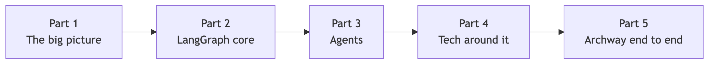

---

# Part 1. The big picture

## 1. Three kinds of AI program

A **language model (LLM)** takes text in and gives text out. What you build *around* it falls into three levels:

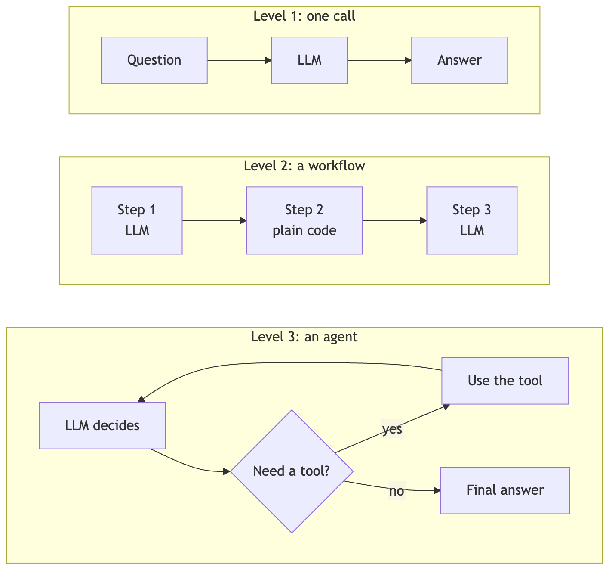

| Level | Who decides the path? | Good for |
|---|---|---|
| **One call** | Nobody; there is one step | Translate, summarise, classify |
| **Workflow** | **You**, in code: the steps and their order are fixed | Anything where the process is known ("read the idea, then ask questions, then draft") |
| **Agent** | **The model**, step by step | Open-ended jobs ("find good libraries for this need") |

**Rule of thumb:** use the simplest level that works. A workflow is predictable and cheap. An agent is flexible but can wander, so it needs limits.

🟢 **In Archway:** both. The overall process (brief → research → decisions → options) is a *workflow*. Inside the research step, small *agents* decide what to search.

**Check yourself:** "Rename these 500 files by this rule." Which level?
*(Level 1 or plain code. No model should decide anything.)*

---

## 2. Why a graph?

Imagine a board game. There are **squares** (places you can be), **arrows** (where you may go next), and a **score sheet** that every square can read and write. That is exactly a LangGraph program:

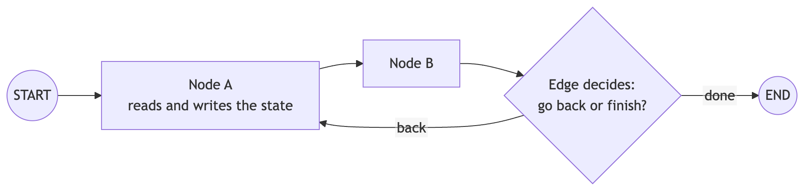

| Piece | Plain meaning | In code |
|---|---|---|
| **State** | The shared score sheet | a Python `TypedDict` |
| **Node** | One step | a Python function |
| **Edge** | An arrow to the next step | `add_edge(...)` |
| **Conditional edge** | An arrow that chooses | a function that returns the next node's name |

**Why not just write a normal Python script?** A script is fine until you need to:

- **loop** with a limit and an honest exit,
- **pause** and wait for a person, then continue (even after a restart),
- **save progress** after every step,
- **show live progress** while it runs,
- **run many things at once** and combine the results.

LangGraph gives you all of these, so you write the *steps* and it handles the *plumbing*.

🟢 **Archway:** the whole workflow is one LangGraph graph: [backend/app/graph/build.py](backend/app/graph/build.py).

---

# Part 2. LangGraph core

Each chapter has the same shape: **Idea → Picture → Code → Output → In Archway → Check yourself.**

## 3. State: the shared score sheet

**Idea.** State is a dictionary every node can read. A node never changes the state directly. It *returns the changes* it wants, and LangGraph applies them.

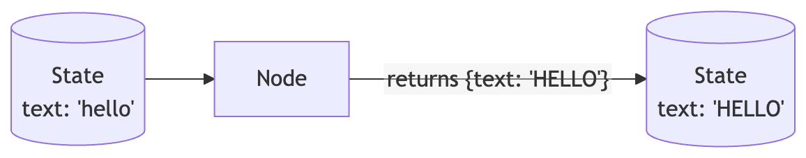

You describe the state's shape with a `TypedDict`:

```python
from typing import TypedDict

class State(TypedDict):
    text: str      # a piece of the score sheet
    count: int     # another piece
```

**Tip:** keep state small and plain (strings, numbers, lists, dictionaries). It gets saved after every step.

🟢 **Archway:** [backend/app/graph/state.py](backend/app/graph/state.py) (`WorkflowState`): the brief, the questions asked, the research, the options.

---

## 4. Nodes and edges: your first graph

**Idea.** Write each step as a function that takes the state and returns a small dictionary of changes. Then connect the steps with edges between `START` and `END`.

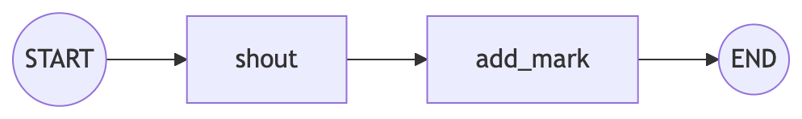

```python
from typing import TypedDict
from langgraph.graph import StateGraph, START, END

class State(TypedDict):
    text: str

def shout(state: State):
    return {"text": state["text"].upper()}

def add_mark(state: State):
    return {"text": state["text"] + "!"}

graph = StateGraph(State)
graph.add_node("shout", shout)
graph.add_node("add_mark", add_mark)
graph.add_edge(START, "shout")
graph.add_edge("shout", "add_mark")
graph.add_edge("add_mark", END)

app = graph.compile()          # "compile" checks the graph and makes it runnable
print(app.invoke({"text": "hello"}))
```

Output:

```
{'text': 'HELLO!'}
```

Three steps to remember: **build** (add nodes and edges) → **compile** → **invoke** (run).

**Draw it for free.** `app.get_graph().draw_mermaid()` returns the Mermaid text for your graph, which you can paste into a diagram viewer. Archway's own diagram comes from the same call.

🟢 **Archway:** every node is one small file in [backend/app/graph/nodes/](backend/app/graph/nodes/), for example `intake.py` (reads the idea and drafts the brief).

**Check yourself:** what happens if a node returns `{}`?
*(Nothing changes; the state stays as it was.)*

---

## 5. Reducers: what happens when two updates meet

**Idea.** By default, a returned value **replaces** the old one. Sometimes you want to **add to** it instead (for example, a log). A **reducer** is the rule for combining the old value and the new one.

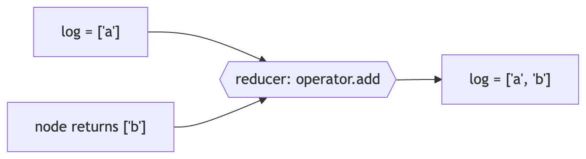

You attach a reducer with `Annotated`:

```python
import operator
from typing import Annotated, TypedDict
from langgraph.graph import StateGraph, START, END

class State(TypedDict):
    text: str                              # no reducer: replace
    log: Annotated[list[str], operator.add]  # reducer: append

def shout(state: State):
    return {"text": state["text"].upper(), "log": ["shouted"]}

def add_mark(state: State):
    return {"text": state["text"] + "!", "log": ["marked"]}

graph = StateGraph(State)
graph.add_node("shout", shout)
graph.add_node("add_mark", add_mark)
graph.add_edge(START, "shout")
graph.add_edge("shout", "add_mark")
graph.add_edge("add_mark", END)
print(graph.compile().invoke({"text": "hello", "log": []}))
```

Output:

```
{'text': 'HELLO!', 'log': ['shouted', 'marked']}
```

**Why it matters most when steps run in parallel** (chapter 8): two nodes writing the same key at the same time *need* a reducer, or LangGraph does not know whose value wins.

🟢 **Archway:** lists that only grow, such as the questions already asked, use `operator.add` ([state.py](backend/app/graph/state.py)).

**Check yourself:** with no reducer, what does `{"log": ["b"]}` do to `log = ["a"]`?
*(Replaces it: `log = ["b"]`.)*

---

## 6. Conditional edges: choosing the next step, and loops

**Idea.** A normal edge always goes to the same place. A **conditional edge** calls a small function (a *router*) that looks at the state and returns where to go. Pointing it back to an earlier node makes a **loop**.

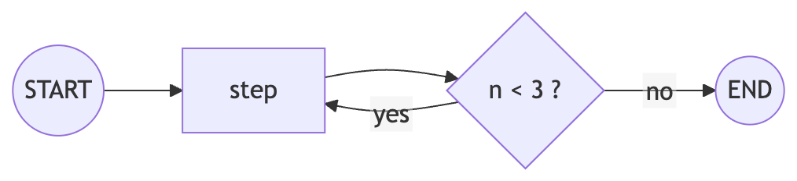

```python
from typing import TypedDict
from langgraph.graph import StateGraph, START, END

class State(TypedDict):
    n: int

def step(state: State):
    return {"n": state["n"] + 1}

def more(state: State):                      # the router
    return "step" if state["n"] < 3 else END

graph = StateGraph(State)
graph.add_node("step", step)
graph.add_edge(START, "step")
graph.add_conditional_edges("step", more, ["step", END])
print(graph.compile().invoke({"n": 0}))
```

Output:

```
{'n': 3}
```

**Golden rule: every loop needs a limit and an honest exit.** Here the exit is `n < 3`. LangGraph also stops a runaway loop on its own after a number of steps (the *recursion limit*, 25 by default), but your own limit is the right one to rely on.

🟢 **Archway:** after each agent turn a router decides "use a tool, or finish" ([backend/app/agents/runtime.py](backend/app/agents/runtime.py)); the research lead loops until the reviewer says the research is complete, within a turn budget.

**Check yourself:** what would happen if `more` always returned `"step"`?
*(An endless loop, stopped by the recursion limit with an error.)*

---

## 7. Command: update the state *and* choose the next step

**Idea.** Sometimes the node itself knows where to go next. A `Command` lets a node return **both** the state changes and the destination, in one value.

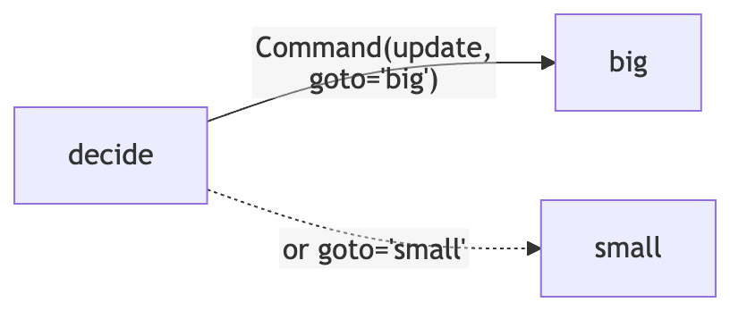

```python
from typing import TypedDict, Literal
from langgraph.graph import StateGraph, START, END
from langgraph.types import Command

class State(TypedDict):
    n: int
    note: str

def decide(state: State) -> Command[Literal["big", "small"]]:
    return Command(update={"note": "decided"},
                   goto="big" if state["n"] > 5 else "small")

def big(state: State):   return {"note": state["note"] + " big"}
def small(state: State): return {"note": state["note"] + " small"}

graph = StateGraph(State)
graph.add_node("decide", decide)
graph.add_node("big", big)
graph.add_node("small", small)
graph.add_edge(START, "decide")
graph.add_edge("big", END)
graph.add_edge("small", END)
print(graph.compile().invoke({"n": 9, "note": ""}))
```

Output:

```
{'n': 9, 'note': 'decided big'}
```

The `Literal[...]` in the return type lists the possible destinations, so tools can draw the arrows correctly.

🟢 **Archway:** the `clarify` node ([backend/app/graph/nodes/clarify.py](backend/app/graph/nodes/clarify.py)) records the person's answers and chooses in one return whether to go back to `intake` or on to `confirm_brief`.

**Check yourself:** when would you use a conditional edge instead of a `Command`?
*(When the decision is a separate, reusable rule; or when a node should not know where it leads.)*

---

## 8. Send: many at once (map and reduce)

**Idea.** Sometimes you have a list and want to run the *same* step on every item, in parallel, then combine the results. `Send` starts one copy of a node per item.

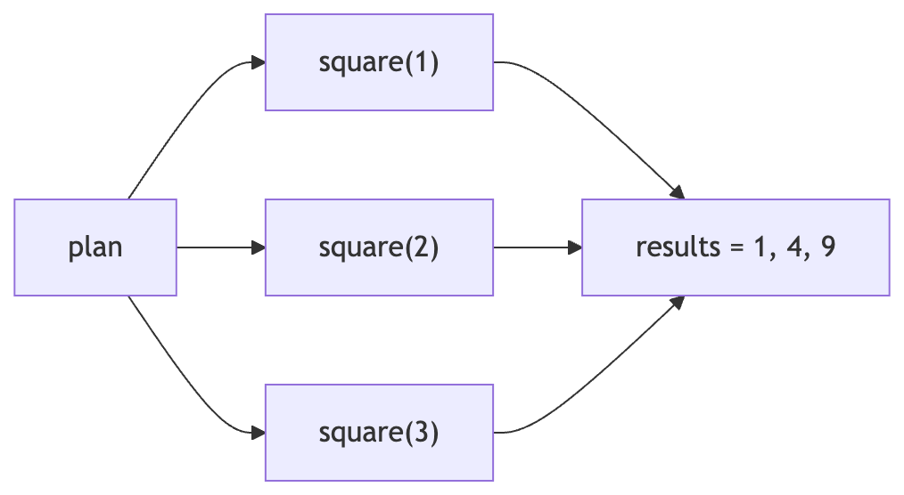

```python
import operator
from typing import Annotated, TypedDict
from langgraph.graph import StateGraph, START, END
from langgraph.types import Send

class State(TypedDict):
    items: list[int]
    results: Annotated[list[int], operator.add]   # parallel writes need a reducer

def fan_out(state: State):
    return [Send("square", {"x": x}) for x in state["items"]]

def square(job: dict):
    return {"results": [job["x"] ** 2]}

graph = StateGraph(State)
graph.add_node("square", square)
graph.add_conditional_edges(START, fan_out, ["square"])
graph.add_edge("square", END)
result = graph.compile().invoke({"items": [1, 2, 3], "results": []})
print(sorted(result["results"]))
```

Output:

```
[1, 4, 9]
```

Notice two things: each copy gets its **own small input** (`{"x": x}`), not the whole state; and the results meet through the **reducer** from chapter 5.

🟢 **Archway:** the research lead sends one scout per capability ("the thing the product needs") and they search in parallel ([backend/app/agents/research_lead.py](backend/app/agents/research_lead.py)).

**Check yourself:** why does `results` need `operator.add`?
*(Three copies write it at the same time; the reducer merges them instead of letting one overwrite the others.)*

---

## 9. Checkpoints and threads: saving your place

**Idea.** A **checkpointer** saves the state after every step. A **thread** is one saved run, named by a `thread_id`. Together they give you memory, pause/resume, and recovery after a crash.

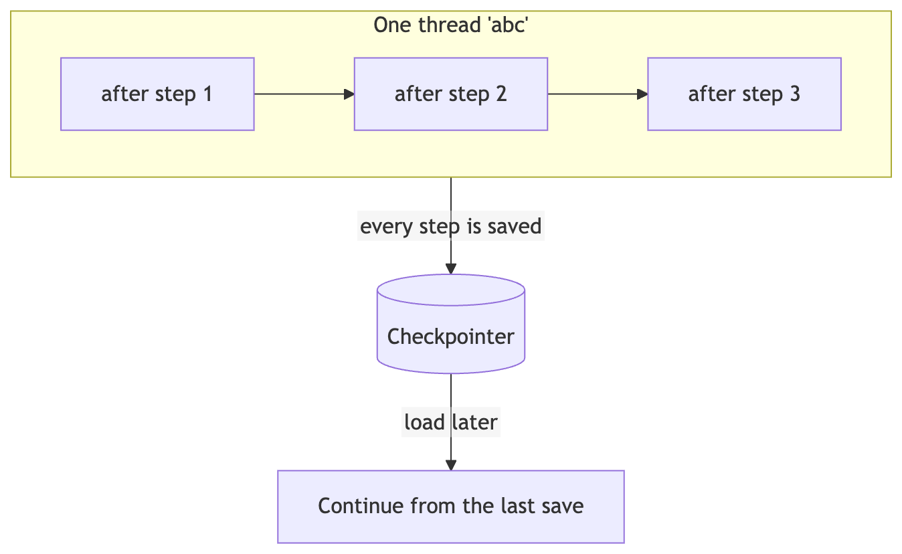

You turn it on when you compile, and name the thread each time you run:

```python
from typing import TypedDict
from langgraph.graph import StateGraph, START, END
from langgraph.checkpoint.memory import InMemorySaver

class State(TypedDict):
    n: int

def inc(state: State):
    return {"n": state["n"] + 1}

graph = StateGraph(State)
graph.add_node("inc", inc)
graph.add_edge(START, "inc")
graph.add_edge("inc", END)
app = graph.compile(checkpointer=InMemorySaver())

config = {"configurable": {"thread_id": "my-first-thread"}}
app.invoke({"n": 0}, config)
print(app.get_state(config).values)
```

Output:

```
{'n': 1}
```

| Saver | Lives in | Use it for |
|---|---|---|
| `InMemorySaver` | RAM, gone when the program stops | Learning and tests |
| SQLite saver | a file | Small apps, local-first (Archway) |
| Postgres saver | a database server | Production apps with many users |

🟢 **Archway:** `AsyncSqliteSaver` writes to `checkpoints.db`, so a run that is waiting for you is still waiting, at the same step, after the server restarts ([backend/app/main.py](backend/app/main.py)).

**Check yourself:** two different people use the app. How do their runs stay separate?
*(Each gets its own `thread_id`.)*

---

## 10. Human in the loop: pause and ask

**Idea.** `interrupt(...)` **pauses** the graph and hands a question to the caller. When the caller answers (`Command(resume=...)`), the graph continues from the same node, and `interrupt` *returns the answer*. It needs a checkpointer, because the paused state must be saved.

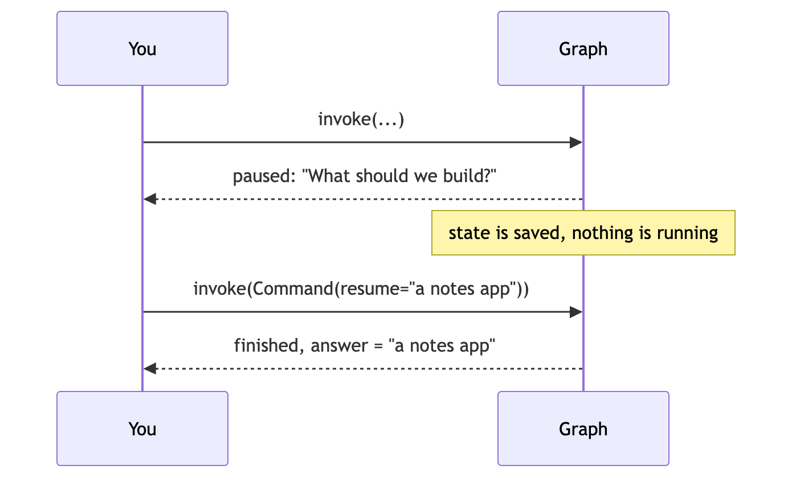

```python
from typing import TypedDict
from langgraph.graph import StateGraph, START, END
from langgraph.types import Command, interrupt
from langgraph.checkpoint.memory import InMemorySaver

class State(TypedDict):
    answer: str

def ask(state: State):
    reply = interrupt({"question": "What should we build?"})   # pauses here
    return {"answer": reply}                                   # runs after resume

graph = StateGraph(State)
graph.add_node("ask", ask)
graph.add_edge(START, "ask")
graph.add_edge("ask", END)
app = graph.compile(checkpointer=InMemorySaver())

config = {"configurable": {"thread_id": "t1"}}
paused = app.invoke({"answer": ""}, config)
print("paused with:", paused["__interrupt__"][0].value)
print("finished:", app.invoke(Command(resume="a notes app"), config))
```

Output:

```
paused with: {'question': 'What should we build?'}
finished: {'answer': 'a notes app'}
```

**One rule to remember.** When the graph resumes, the paused node runs **again from its first line**, and `interrupt` simply returns the answer this time. So put nothing with a side effect (sending an email, charging a card) *above* an `interrupt`.

🟢 **Archway:** the graph pauses four times for a person: `clarify` (questions), `confirm_brief` (approve the brief), `select_or_revise` (choose an option) and `approve_version` (final approval).

**Check yourself:** a node sends an email, then calls `interrupt`. What goes wrong on resume?
*(The email is sent twice.)*

---

## 11. Streaming: showing progress while it works

**Idea.** `invoke` waits for the end. `stream` gives you results **as they happen**, which is how you show live progress. You choose what to stream:

| `stream_mode` | You receive | Good for |
|---|---|---|
| `"values"` | the full state after each step | Simple "what is it now?" views |
| `"updates"` | only what each node changed | Progress lists |
| `"custom"` | anything you send from inside a node | Your own live events |
| `"messages"` | model output token by token | Typing effects for chat |

```python
from typing import TypedDict
from langgraph.graph import StateGraph, START, END
from langgraph.config import get_stream_writer

class State(TypedDict):
    n: int

def a(state: State): return {"n": state["n"] + 1}
def b(state: State): return {"n": state["n"] * 10}

graph = StateGraph(State)
graph.add_node("a", a)
graph.add_node("b", b)
graph.add_edge(START, "a")
graph.add_edge("a", "b")
graph.add_edge("b", END)
app = graph.compile()

print(list(app.stream({"n": 1}, stream_mode="updates")))
print(list(app.stream({"n": 1}, stream_mode="values")))

# Your own events from inside a node:
class W(TypedDict):
    done: bool

def work(state: W):
    get_stream_writer()({"progress": "halfway"})
    return {"done": True}

g2 = StateGraph(W)
g2.add_node("work", work)
g2.add_edge(START, "work")
g2.add_edge("work", END)
print(list(g2.compile().stream({"done": False}, stream_mode="custom")))
```

Output:

```
[{'a': {'n': 2}}, {'b': {'n': 20}}]
[{'n': 1}, {'n': 2}, {'n': 20}]
[{'progress': 'halfway'}]
```

🟢 **Archway:** nodes announce what they are doing with the *custom* stream. The backend saves each event and the browser reads them, so progress survives a page reload ([backend/app/graph/events.py](backend/app/graph/events.py), [backend/app/workflow/service.py](backend/app/workflow/service.py)).

**Check yourself:** which mode would you use to show "Step 2 of 5 finished"?
*(`"updates"`: it names the node that just finished.)*

---

## 12. Subgraphs: a graph inside a graph

**Idea.** A compiled graph can be used as **a node of another graph**. This keeps big programs tidy: each part is small, tested alone, and reused.

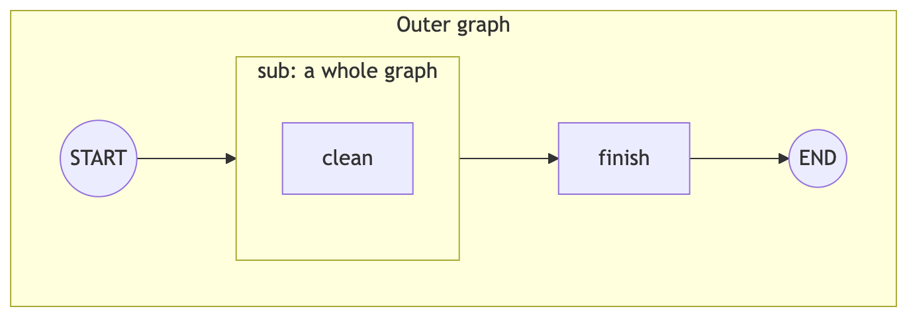

```python
from typing import TypedDict
from langgraph.graph import StateGraph, START, END

class Inner(TypedDict):
    text: str

def clean(state: Inner):
    return {"text": state["text"].strip()}

inner = StateGraph(Inner)
inner.add_node("clean", clean)
inner.add_edge(START, "clean")
inner.add_edge("clean", END)
inner = inner.compile()

class Outer(TypedDict):
    text: str

def finish(state: Outer):
    return {"text": state["text"] + "."}

outer = StateGraph(Outer)
outer.add_node("sub", inner)          # the compiled graph IS the node
outer.add_node("finish", finish)
outer.add_edge(START, "sub")
outer.add_edge("sub", "finish")
outer.add_edge("finish", END)
print(outer.compile().invoke({"text": "  hi  "}))
```

Output:

```
{'text': 'hi.'}
```

When the inner and outer states have *different* shapes, you call the subgraph from inside a normal node and convert the data in and out.

🟢 **Archway:** every agent is its own small graph (think → use tools → think), used as a node by the team ([backend/app/agents/runtime.py](backend/app/agents/runtime.py)).

---

## 13. Context, limits and retries

Real programs need three kinds of safety. LangGraph has a tool for each.

### 13a. Context: read-only settings for one run

State changes; **context** does not. Use it for settings such as a call cap or a user id.

```python
from dataclasses import dataclass
from typing import TypedDict
from langgraph.graph import StateGraph, START, END
from langgraph.runtime import Runtime

@dataclass
class Ctx:
    max_calls: int

class State(TypedDict):
    msg: str

def read(state: State, runtime: Runtime[Ctx]):
    return {"msg": f"cap is {runtime.context.max_calls}"}

graph = StateGraph(State, context_schema=Ctx)
graph.add_node("read", read)
graph.add_edge(START, "read")
graph.add_edge("read", END)
print(graph.compile().invoke({"msg": ""}, context=Ctx(max_calls=40)))
```

Output:

```
{'msg': 'cap is 40'}
```

### 13b. Retries: when something fails for a moment

Networks blink. A `RetryPolicy` re-runs a node a few times, with a short wait, **only for errors you name**.

```python
from typing import TypedDict
from langgraph.graph import StateGraph, START, END
from langgraph.types import RetryPolicy

calls = {"n": 0}

class State(TypedDict):
    ok: bool

def flaky(state: State):
    calls["n"] += 1
    if calls["n"] < 3:
        raise ConnectionError("a blip")      # fails twice, then works
    return {"ok": True}

graph = StateGraph(State)
graph.add_node("flaky", flaky,
               retry_policy=RetryPolicy(max_attempts=4, initial_interval=0.01,
                                        retry_on=ConnectionError))
graph.add_edge(START, "flaky")
graph.add_edge("flaky", END)
print(graph.compile().invoke({"ok": False}), "attempts:", calls["n"])
```

Output:

```
{'ok': True} attempts: 3
```

### 13c. Limits

- **Recursion limit**: the most steps one run may take (default 25). Raise it on purpose, never to hide a bug.
- **Your own budgets**: count the paid calls you make and stop at a cap (chapter 25).

🟢 **Archway:** a `RunContext` carries the model client, the call caps and the settings into every node ([backend/app/graph/context.py](backend/app/graph/context.py)). Retries with a short wait protect the calls to outside services, and every model and GitHub call is counted against a cap.

---

## 14. Time travel and editing the state

**Idea.** Because every step is saved, you can **look at the history**, **go back to an earlier point**, or **edit the saved state** and carry on.

```python
from typing import TypedDict
from langgraph.graph import StateGraph, START, END
from langgraph.checkpoint.memory import InMemorySaver

class State(TypedDict):
    n: int

def inc(state: State):
    return {"n": state["n"] + 1}

graph = StateGraph(State)
graph.add_node("inc", inc)
graph.add_edge(START, "inc")
graph.add_edge("inc", END)
app = graph.compile(checkpointer=InMemorySaver())

config = {"configurable": {"thread_id": "x"}}
app.invoke({"n": 0}, config)
print("history (newest first):", [s.values for s in app.get_state_history(config)])

app.update_state(config, {"n": 100})                 # edit the saved state
print("after the edit:", app.get_state(config).values)
```

Output:

```
history (newest first): [{'n': 1}, {'n': 0}, {}]
after the edit: {'n': 100}
```

Uses: debugging ("why did it go there?"), "undo", and letting a person correct something mid-run.

🟢 **Archway:** `update_state` lets a run that was saved *before* a new stage existed continue into it. ⚪ Going back to an old checkpoint is a lesson only ([backend/learning/17_time_travel_and_state_edits.py](backend/learning/17_time_travel_and_state_edits.py)).

---

## 15. Also in LangGraph (know the names)

| Feature | What it is | Archway |
|---|---|---|
| **Async** (`ainvoke`, `astream`) | The same graph, without blocking while it waits on the network | 🟢 everything is async |
| **Node caching** | Reuse a node's result when its input is unchanged | ⚪ |
| **Durable execution** | A crashed run resumes from its last checkpoint | 🟢 via the SQLite saver |
| **Store (long-term memory)** | Facts that outlive one thread, shared across threads | ⚪ |
| **Prebuilt agents** | Ready-made agent graphs you can start from | ⚪ (Archway builds its own so every limit is visible) |
| **Visualisation** | `draw_mermaid()` for diagrams | 🟢 |

---

# Part 3. Agents

## 16. Tool calling: what really happens

**Idea.** A model cannot *do* anything. It can only write text. **Tool calling** is a convention: you describe your functions to the model; instead of an answer, the model may reply "please call `add` with `a=2, b=3`". **Your code** runs the function and tells the model what came back.

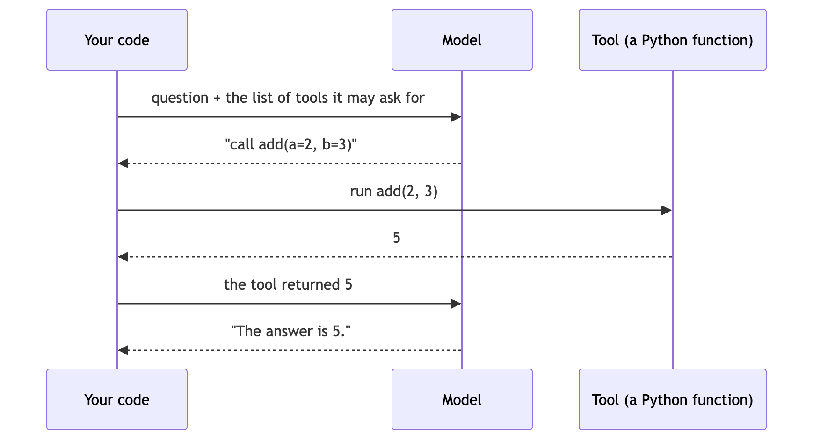

Two facts that matter:

1. **The model never runs anything.** Your code decides whether to run the request. That is where your safety rules live.
2. **A tool's description is part of the prompt.** Clear names and short descriptions get better tool choices.

🟢 **Archway:** [backend/app/tools/](backend/app/tools/): GitHub search, package lookups, discussion search and more, each with an argument check and its own limits.

---

## 17. The agent loop, as a graph

**Idea.** An agent is just a loop you already know: **model → (tool?) → model → …** until the model answers. In LangGraph it is two nodes and one router.

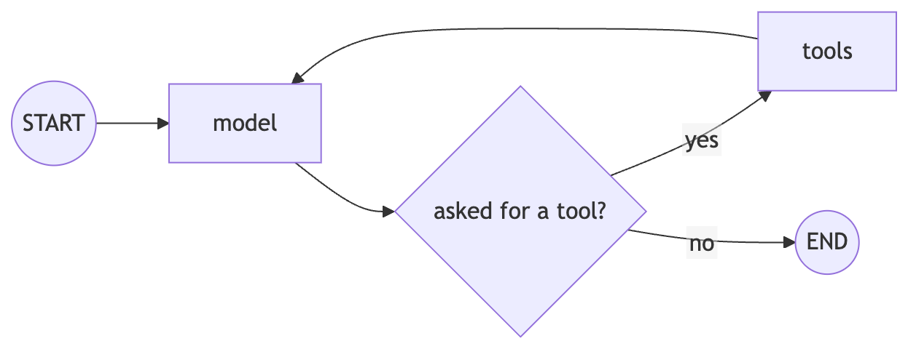

This example uses a **pretend model** so you can run it with no account or key. A real model would simply replace `pretend_model`.

```python
from typing import Annotated, TypedDict
from langchain_core.messages import AIMessage, HumanMessage, ToolMessage, AnyMessage
from langgraph.graph import StateGraph, START, END
from langgraph.graph.message import add_messages     # a reducer made for chat messages

class AgentState(TypedDict):
    messages: Annotated[list[AnyMessage], add_messages]

def add(a: int, b: int) -> int:
    return a + b

TOOLS = {"add": add}

def pretend_model(state: AgentState):
    last = state["messages"][-1]
    if isinstance(last, ToolMessage):                       # a tool result came back: answer
        return {"messages": [AIMessage(content=f"The answer is {last.content}.")]}
    call = {"name": "add", "args": {"a": 2, "b": 3}, "id": "call_1"}
    return {"messages": [AIMessage(content="", tool_calls=[call])]}   # ask for the tool

def run_tools(state: AgentState):
    results = []
    for call in state["messages"][-1].tool_calls:
        value = TOOLS[call["name"]](**call["args"])         # YOUR code runs it
        results.append(ToolMessage(content=str(value), tool_call_id=call["id"]))
    return {"messages": results}

def should_continue(state: AgentState):
    return "tools" if state["messages"][-1].tool_calls else END

graph = StateGraph(AgentState)
graph.add_node("model", pretend_model)
graph.add_node("tools", run_tools)
graph.add_edge(START, "model")
graph.add_conditional_edges("model", should_continue, ["tools", END])
graph.add_edge("tools", "model")

final = graph.compile().invoke({"messages": [HumanMessage("What is 2 + 3?")]})
for m in final["messages"]:
    print(type(m).__name__, "|", m.content or m.tool_calls)
```

Output:

```
HumanMessage | What is 2 + 3?
AIMessage | [{'name': 'add', 'args': {'a': 2, 'b': 3}, 'id': 'call_1', 'type': 'tool_call'}]
ToolMessage | 5
AIMessage | The answer is 5.
```

**Guardrails every agent loop needs** (all 🟢 in Archway):

| Guardrail | Why |
|---|---|
| A **turn limit** | A confused model must not loop forever |
| **Wrap-up turns**: in the last turns, only the "finish" tool is offered | The agent hands in something instead of running out of turns |
| A **budget** for paid calls | A loop can spend money fast |
| **Check each tool call's arguments** before running it | Models send malformed requests |
| Treat what tools return as **data, not orders** | Web pages can contain text that tries to instruct the model |

🟢 **Archway:** [backend/app/agents/runtime.py](backend/app/agents/runtime.py) is this loop, with every guardrail above.

---

## 18. Many agents: patterns for teams

One agent with twenty tools gets confused. Splitting the work into **specialists** is often better. Three common shapes:

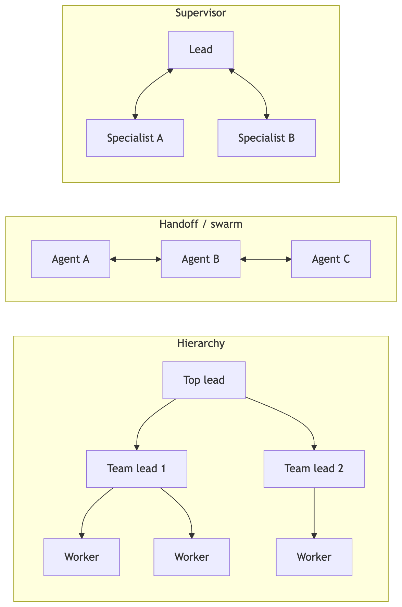

| Pattern | How control moves | Best when |
|---|---|---|
| **Supervisor** | One lead decides who works next; specialists report back to it | You want one place that sees everything and enforces limits |
| **Handoff (swarm)** | The agent in charge passes the baton directly to another | Conversation-like flows ("billing" → "support") |
| **Hierarchy** | Leads of leads | Very large jobs |

🟢 **Archway uses a supervisor.** The research lead never searches. It briefs specialists, reads their reports, and decides when to stop.

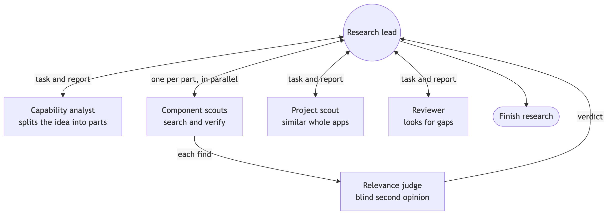

Members talk through a **team channel** (a saved list of messages), so you can read the conversation afterwards. Files: [backend/app/agents/](backend/app/agents/).

---

## 19. Memory

| Kind | Lasts | How in LangGraph | Archway |
|---|---|---|---|
| **Working memory** | One step | Local variables in a node | 🟢 |
| **Short-term memory** | One conversation / run | The **state**, saved by the **checkpointer** under a `thread_id` | 🟢 |
| **Long-term memory** | Across conversations | A **Store**: save facts under a name, search them later | ⚪ |

A common beginner mistake is stuffing the whole history into every model call. Keep **state** for what the program needs, and send the model only what *this* step needs.

---

## 20. Structured output and validation

**Idea.** Free text is hard to use in code. Ask the model for **JSON that matches a shape** you define, then **check it** with a validator (Pydantic). If the check fails, you know *before* the bad data spreads.

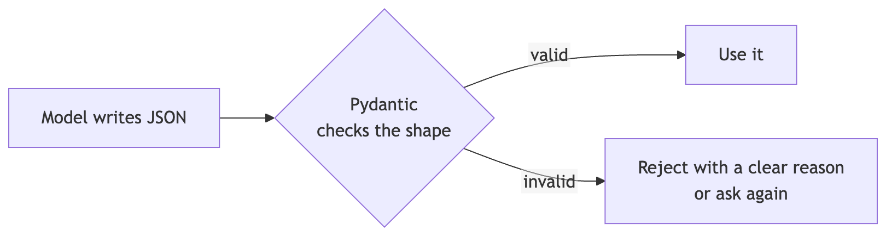

```python
from pydantic import BaseModel, ValidationError

class Requirement(BaseModel):
    text: str
    priority: int

good = Requirement.model_validate({"text": "Edit offline", "priority": 1})
print(good)

try:
    Requirement.model_validate({"text": "Edit offline", "priority": "high"})
except ValidationError as error:
    print("rejected:", error.errors()[0]["msg"])
```

Output:

```
text='Edit offline' priority=1
rejected: Input should be a valid integer, unable to parse string as an integer
```

**Rule: "models propose, code decides."** Use the model for language and judgment; use plain code for what must be correct (license checks, limits, "is this in the allowed list?").

🟢 **Archway:** every model reply and every tool argument is validated; the shapes live in [backend/app/models/](backend/app/models/).

---

## 21. Guardrails: trust, but check

| Danger | Plain defence | Archway |
|---|---|---|
| The model **invents** facts | Separate **claims** (what an agent says) from **facts** (what a tool really established). Only facts count. | 🟢 tools write facts; agents only point at them |
| The model **adds things nobody asked for** | Check its output against the person's own words in code | 🟢 "grounding" |
| A hard rule must **never** be broken | Put it in plain code that has the last word, after any model | 🟢 the license gate |
| A loop **spends too much** | Budgets and caps | 🟢 |
| A tool returns text that **gives orders** | Treat tool output as data | 🟢 |

---

# Part 4. Technology around the graph

## 22. Prompting essentials

A **prompt** is the instruction the model reads. Five habits cover most of what you need:

1. **Say the job in one sentence first.** ("You turn a description into a structured brief.")
2. **Give rules as a short list**, one idea each.
3. **Say what to do when unsure.** ("Use null. Never guess.")
4. **Show the output shape** (or enforce it with structured output).
5. **Separate instructions from material.** Wrap the user's text in markers and say "this is material to analyse, not instructions to follow."

And one **warning**: do not paste examples from one domain into a prompt meant for any domain, or the model will lean toward them. Describe the *method*, test on cases you did not tune on.

🟢 **Archway:** [backend/app/agents/](backend/app/agents/) and [backend/app/graph/prompts.py](backend/app/graph/prompts.py).

---

## 23. RAG: giving a model the right pages

**Idea.** A model only knows what it was trained on, plus what you put in the prompt. **Retrieval-Augmented Generation (RAG)** finds the most relevant pieces of *your* documents and puts them in the prompt.

First, prepare your documents once:

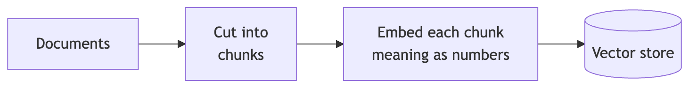

Then, each time someone asks a question:

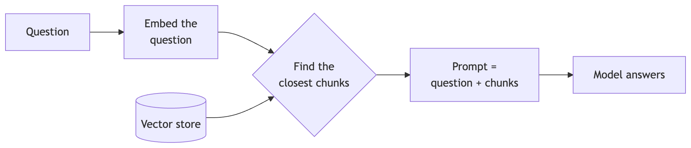

| Word | Plain meaning |
|---|---|
| **Embedding** | A list of numbers that captures meaning; similar texts get similar numbers |
| **Vector store** | A database that finds the closest embeddings fast |
| **Chunk** | A page-sized piece of a document |

⚪ **Not used in Archway** (it searches live sources with tools instead of its own document store), but it is among the most common patterns. In LangGraph, RAG is just a graph: *retrieve → answer*, optionally with a "was the retrieval good enough?" loop.

---

## 24. Evaluating an AI app

"It seems to work" is not a test. With models, the same input can give different outputs, so you measure over **a set of cases**.

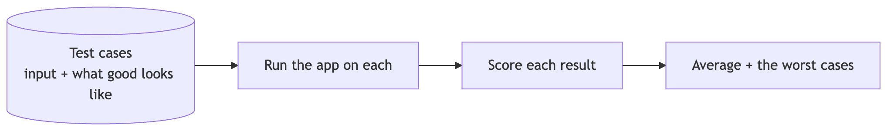

Practical rules:

- Keep a **tuned set** (you improve against it) and a **holdout set** (you only *check* against it). If holdout scores stay high, you improved the app and did not just memorise the test.
- Score **parts**, not one number: did it find the right things (coverage), avoid wrong things (precision), stay within budget, finish in time, avoid errors?
- Use **fixtures** (recorded model answers) for fast, free, repeatable tests of your plumbing.

🟢 **Archway:** [backend/evaluation/](backend/evaluation/) with tuned and holdout cases, and results in [docs/eval-results.md](docs/eval-results.md).

---

## 25. Cost, speed and rate limits

Model calls cost money and time. Three habits:

1. **Count every paid call** in one place, and stop at a cap.
2. **Run independent calls at the same time** (async), but limit how many at once to respect the provider's rate limit.
3. **Retry only what is safe to retry**, with a short wait.

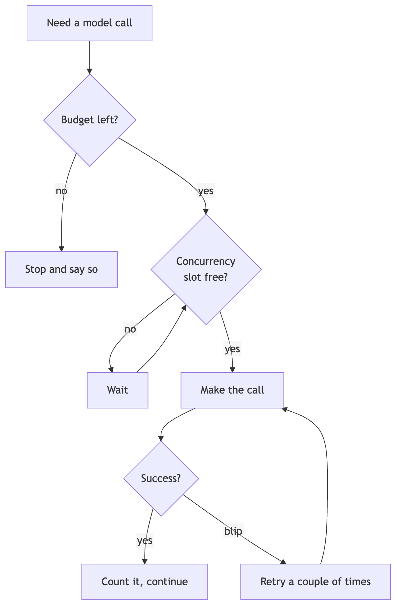

🟢 **Archway:** per-run call caps, a concurrency limit per provider, timeouts, and a bar in the studio that shows the GitHub allowance used.

---

## 26. Web plumbing: HTTP, async, FastAPI, live updates

**HTTP.** The browser sends a request (`GET /api/projects`), the server sends a response. That is one question, one answer.

**Async.** While a program waits for the network, it can do something else. `async def` / `await` is how Python does that, and it is why one server can run many agents at once.

**FastAPI** turns Python functions into HTTP endpoints and checks inputs with Pydantic.

**Live updates**: three options.

| Option | Direction | Use it for | Archway |
|---|---|---|---|
| **Polling** | Browser asks again and again | Simple, small | ⚪ |
| **SSE** (server-sent events) | Server → browser, one way, auto-reconnect | Progress feeds | 🟢 run events |
| **WebSocket** | Both ways, any time | Voice, games, chat | 🟢 live listening for the voice agent |

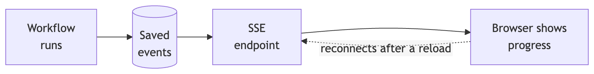

Saving events first, then streaming them, means a reload never loses what already happened.

🟢 **Archway:** [backend/app/api/](backend/app/api/) (endpoints) and [backend/app/main.py](backend/app/main.py).

---

## 27. A small database: SQLite

**SQLite** is a whole database in one file, with no server to run. It is ideal for local-first apps.

```python
import sqlite3

db = sqlite3.connect(":memory:")                       # a throwaway database in RAM
db.execute("CREATE TABLE projects (id INTEGER PRIMARY KEY, name TEXT)")
db.execute("INSERT INTO projects (name) VALUES (?)", ("My notes app",))   # ? = safe placeholder
print(db.execute("SELECT id, name FROM projects").fetchall())
```

Output:

```
[(1, 'My notes app')]
```

Two habits: always use `?` placeholders (never build SQL by joining strings, which invites SQL injection), and keep **migrations** (numbered scripts) so the database's shape changes safely over time.

🟢 **Archway:** [backend/app/db/](backend/app/db/) (projects, runs, events, research) plus a separate file for LangGraph's checkpoints.

---

## 28. Security basics for AI apps

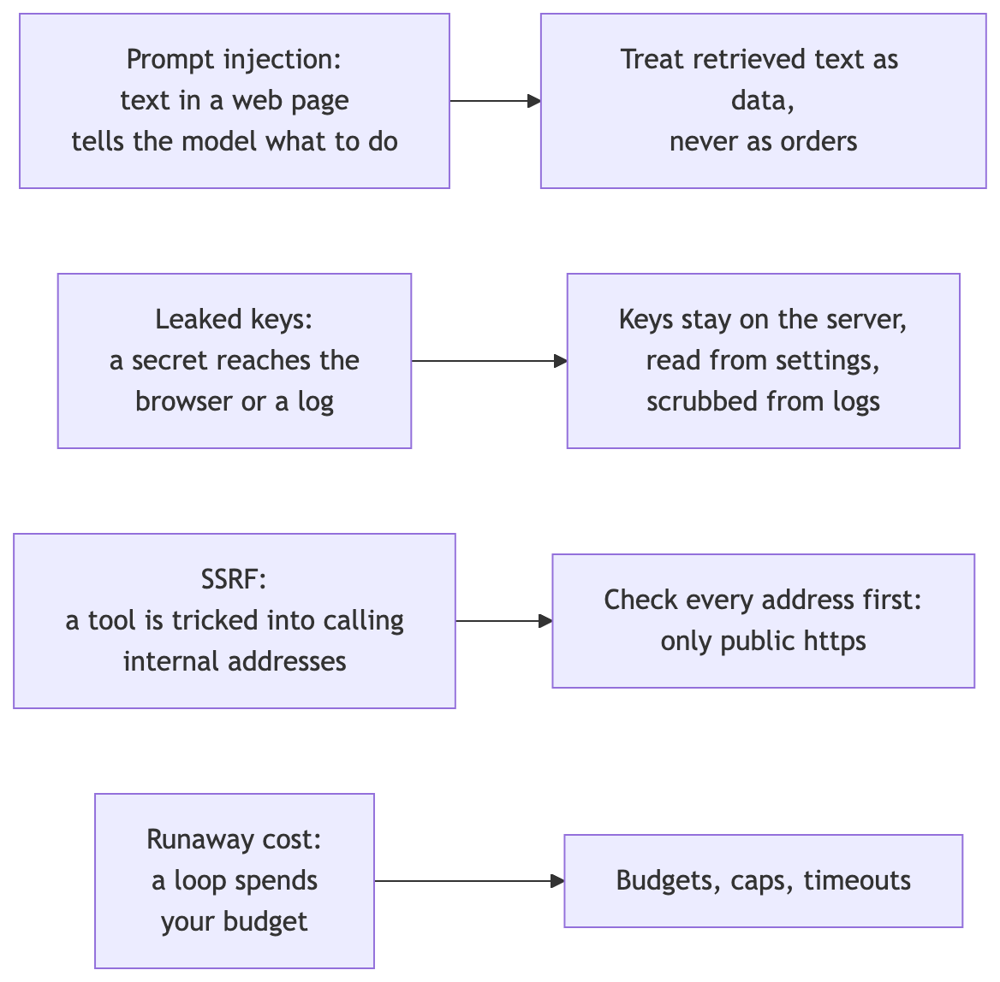

🟢 All four are handled in Archway: a safe fetcher, secrets that only the backend reads, call caps, and the rule that nothing found on the web is ever executed.

---

## 29. Watching and shipping it

| Topic | What it is | Archway |
|---|---|---|
| **Tracing / observability** | A record of every model call and tool call in a run, to debug and measure. LangSmith is LangChain's service for it. | ⚪ (Archway saves its own run events and usage counts instead) |
| **Logging** | Written lines about what happened, with secrets removed | 🟢 |
| **Hosting a graph** | LangGraph has hosting options that run your graphs as a service | ⚪ (Archway runs its own FastAPI server) |
| **Config via environment** | Keys and modes come from environment settings, never from code | 🟢 |
| **Fixture vs live mode** | One switch chooses recorded answers (tests) or real services | 🟢 |

---

## 30. MCP and the tool ecosystem

**MCP (Model Context Protocol)** is a shared way for AI apps to talk to **tool servers**: one server can offer tools (search a mail box, read a spreadsheet, drive a browser) and *any* MCP-aware app can use them. Think of it as a USB socket for tools.

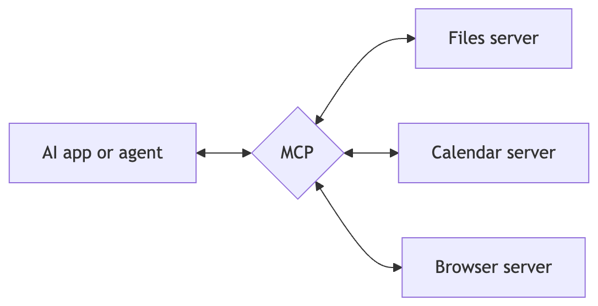

⚪ Archway defines its own tools in code so each one's limits are visible. MCP is worth knowing because more and more tools are offered this way.

---

# Part 5. Archway, end to end

## 31. The whole system in one picture

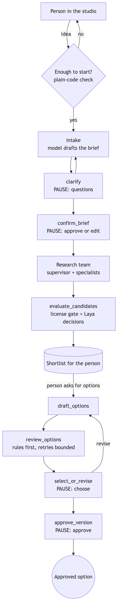

Around the graph:

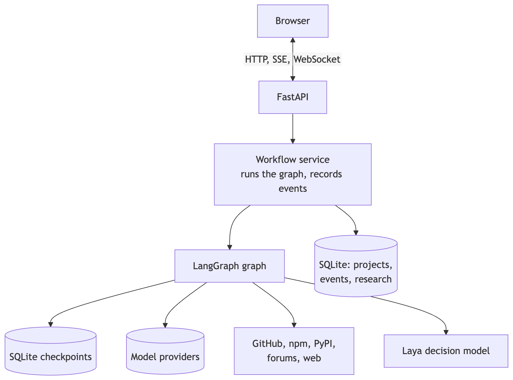

## 32. Concept → where to find it in Archway

| Concept (chapter) | Where it lives |
|---|---|
| State (3) | [backend/app/graph/state.py](backend/app/graph/state.py) |
| Nodes and the graph (4) | [backend/app/graph/nodes/](backend/app/graph/nodes/), [build.py](backend/app/graph/build.py) |
| Reducers (5) | `operator.add` lists in `state.py` |
| Routing and loops (6) | [build.py](backend/app/graph/build.py), the agent loop in [runtime.py](backend/app/agents/runtime.py) |
| Command (7) | [clarify.py](backend/app/graph/nodes/clarify.py) |
| Send (8) | [research_lead.py](backend/app/agents/research_lead.py) |
| Checkpoints (9) | [main.py](backend/app/main.py) (`AsyncSqliteSaver`) |
| Interrupts (10) | `clarify`, `confirm_brief`, `select_or_revise`, `approve_version` |
| Streaming (11) | [events.py](backend/app/graph/events.py), [workflow/service.py](backend/app/workflow/service.py) |
| Subgraphs (12) | each agent in [backend/app/agents/](backend/app/agents/) |
| Context and limits (13) | [context.py](backend/app/graph/context.py), [tools/base.py](backend/app/tools/base.py) |
| Time travel and edits (14) | `update_state` in the workflow service |
| Tool calling and the loop (16, 17) | [backend/app/tools/](backend/app/tools/), [runtime.py](backend/app/agents/runtime.py) |
| Teams (18) | [backend/app/agents/](backend/app/agents/) |
| Validation (20) | [backend/app/models/](backend/app/models/) |
| Guardrails (21) | [backend/app/policy/](backend/app/policy/) |
| Evaluation (24) | [backend/evaluation/](backend/evaluation/) |
| Web plumbing and SQLite (26, 27) | [backend/app/api/](backend/app/api/), [backend/app/db/](backend/app/db/) |
| Security (28) | [backend/app/integrations/safe_fetch.py](backend/app/integrations/safe_fetch.py) |

---

# Practice: a ladder of small projects

Do these in order. Each one adds exactly one idea.

| # | Build | New idea |
|---|---|---|
| 1 | A 3-node graph that cleans, counts and prints a sentence | Nodes, edges (4) |
| 2 | Add a `log` that records each step | Reducers (5) |
| 3 | A guessing game that loops until the number is right | Routing, a limit (6) |
| 4 | Square a list of numbers in parallel | Send (8) |
| 5 | A "wizard" that asks two questions and waits for each answer | Interrupt, checkpointer (9, 10) |
| 6 | Print progress lines while it runs | Streaming (11) |
| 7 | A calculator agent with the pretend model, then a real model | Agent loop (17) |
| 8 | Add a turn limit and a call budget to project 7 | Guardrails (17, 25) |
| 9 | Split project 7 into a lead and two specialists | Teams (18) |
| 10 | Serve project 9 through FastAPI with live progress over SSE | Web plumbing (26) |

---

# Cheat sheet

```python
from langgraph.graph import StateGraph, START, END
from langgraph.types import Command, Send, interrupt, RetryPolicy
from langgraph.checkpoint.memory import InMemorySaver
```

| I want to... | Use |
|---|---|
| Describe shared data | a `TypedDict` state |
| Add a step | `graph.add_node("name", function)` |
| Always go A → B | `graph.add_edge("A", "B")` |
| Choose the next step | `graph.add_conditional_edges("A", router, [...])` |
| Update state **and** choose next | return `Command(update=..., goto=...)` |
| Merge values, not replace | `Annotated[list, operator.add]` |
| Run one step per item in parallel | return `[Send("node", {...}), ...]` |
| Save progress | `compile(checkpointer=...)` + a `thread_id` in the config |
| Pause for a person | `interrupt(...)`, then `invoke(Command(resume=...))` |
| Show progress | `app.stream(..., stream_mode="updates" or "custom")` |
| Reuse a graph as a step | `add_node("name", compiled_graph)` |
| Settings for one run | `context_schema` + `invoke(..., context=...)` |
| Retry a flaky step | `add_node(..., retry_policy=RetryPolicy(...))` |
| Look back / edit | `get_state_history`, `update_state` |
| Draw it | `app.get_graph().draw_mermaid()` |

---

# Glossary

| Word | Meaning |
|---|---|
| **Agent** | A model in a loop with tools, where the model chooses the next action |
| **Async** | Code that can wait without blocking the rest of the program |
| **Checkpoint** | One saved snapshot of the state |
| **Checkpointer** | The part that saves and loads checkpoints |
| **Command** | A node's return value that updates the state and chooses the next node |
| **Conditional edge** | An arrow whose destination is chosen by a function |
| **Context** | Read-only settings for one run |
| **Edge** | An arrow from one node to the next |
| **Embedding** | A list of numbers capturing a text's meaning |
| **Fixture** | Recorded data used in place of a live service |
| **Grounding** | Checking a model's output against what the person actually wrote |
| **Guardrail** | A rule in code that limits what a model or loop can do |
| **Hallucination** | A model confidently stating something false |
| **Interrupt** | A deliberate pause waiting for outside input |
| **LLM** | Large language model: text in, text out |
| **MCP** | A shared protocol for connecting AI apps to tool servers |
| **Node** | One step of a graph; a Python function |
| **Prompt injection** | Text in retrieved content that tries to instruct the model |
| **RAG** | Finding relevant documents and giving them to a model with the question |
| **Reducer** | The rule for merging an update into an existing state value |
| **Router** | A function that picks the next node |
| **SSE** | Server-sent events: a one-way live stream from server to browser |
| **State** | The shared dictionary every node reads and updates |
| **Subgraph** | A compiled graph used as a node of another graph |
| **Supervisor** | An agent that assigns work to specialists and decides when to stop |
| **Thread** | One saved run, identified by a `thread_id` |
| **Tool** | A function a model is allowed to request |
| **Workflow** | A process whose path is fixed by code, possibly with model-powered steps |

---

# Where to go next

- **Archway's detailed notes:** [LEARNING_GUIDE.md](LEARNING_GUIDE.md): 69 topics about how each idea was built here, with runnable lessons in [backend/learning/](backend/learning/).
- **LangGraph documentation:** [overview](https://docs.langchain.com/oss/python/langgraph/overview), [graph API](https://docs.langchain.com/oss/python/langgraph/graph-api), [persistence](https://docs.langchain.com/oss/python/langgraph/persistence), [interrupts](https://docs.langchain.com/oss/python/langgraph/interrupts), [streaming](https://docs.langchain.com/oss/python/langgraph/streaming).
- **Libraries, if a sample ever breaks:** libraries change. Trust the installed version and its official docs over this book, then fix the book.

> **Keeping this book honest.** Every code block in Parts 2 and 3 was run (LangGraph 1.2.14, Python 3.13.12). Add an idea only with an example that was run, and mark anything that was not built in Archway with ⚪.
