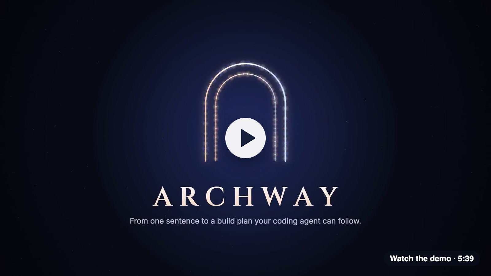
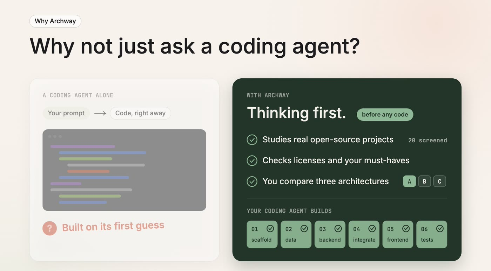
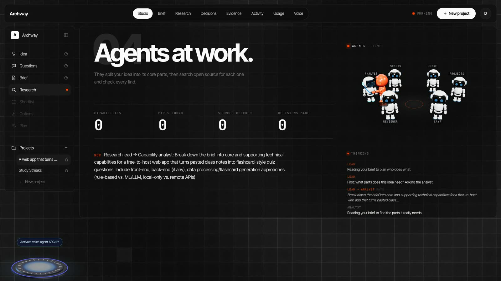
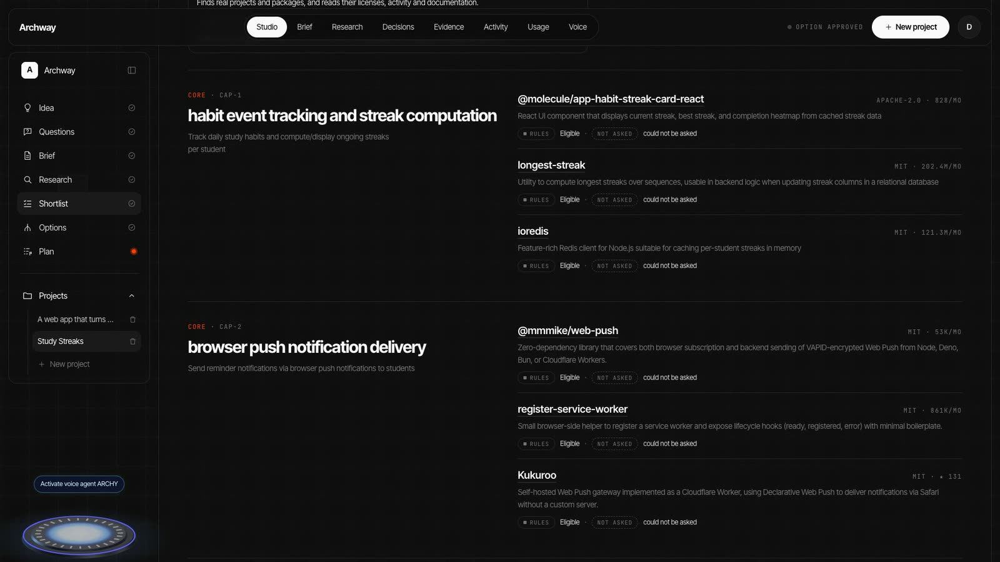
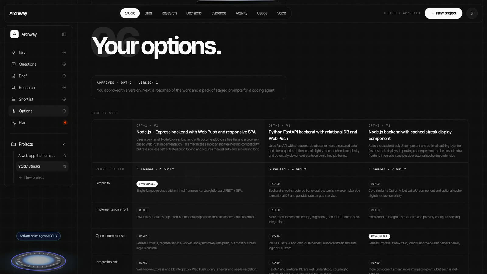
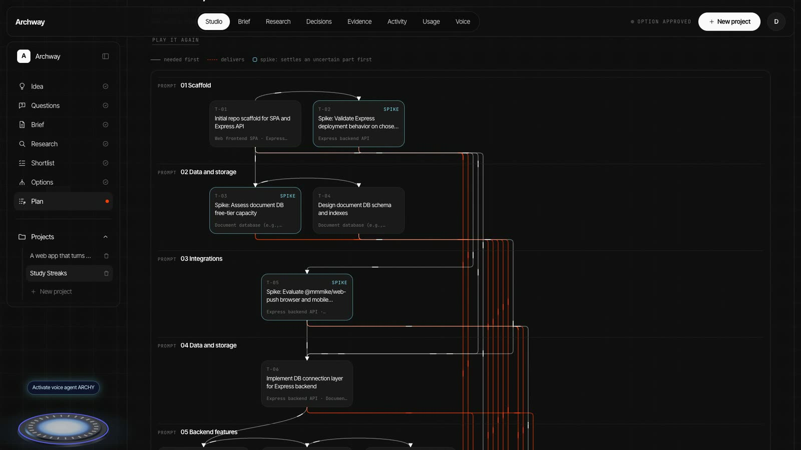

<p align="center">
  
</p>

<h3 align="center">From one sentence to a build plan your coding agent can follow.</h3>

<p align="center">
  An AI architecture studio. A team of agents researches real open-source projects, proposes architectures you can compare, and writes the step-by-step prompts to build the one you choose.
</p>

<p align="center">
  <a href="https://archway-beta-five.vercel.app"><strong>Try it live</strong></a> ·
  <a href="#demo"><strong>Watch the demo</strong></a> ·
  <a href="#quick-start"><strong>Quick start</strong></a>
</p>

<p align="center">
  
  
  
  
</p>

---

## Demo

<p align="center">
  <a href="https://archway-beta-five.vercel.app/demo.mp4"></a>
</p>


---

## Why Archway? Couldn't you just vibe code it?

You could, and for a weekend throwaway you should.

But a coding agent starts writing the moment you press enter. The decisions that are hardest to undo (which libraries, which architecture, which licenses you now depend on) get made by its first guess, and you find out later.

Archway makes those decisions first, with evidence. Then it hands your coding agent a plan.

<p align="center">
  
</p>

| | Vibe coding alone | With Archway |
| --- | --- | --- |
| **Choosing parts** | Whatever the model remembers | Live research across real projects |
| **Licenses and dead projects** | Discovered later, if at all | Checked by plain code before anything is recommended |
| **Architecture** | One, chosen for you | Up to three, compared side by side |
| **Instructions** | One giant prompt | Small, ordered steps, each with its goal, guard rails and tests |
| **Trust** | Take its word for it | Every claim is one click from its source |

**Archway doesn't replace your coding agent. It tells it what to build.** The prompts are plain text, so they work with the agent you already use.

## How it works

| Step | What happens |
| --- | --- |
| **1. Idea** | Describe what you want to build in a sentence, typed or spoken. |
| **2. Questions** | The agents ask only what they need. Anything you skip becomes a stated assumption. |
| **3. Brief** | Your idea becomes an editable brief. Nothing moves on until you approve it. |
| **4. Research** | The team searches open-source projects live, while you watch. |
| **5. Shortlist** | The best parts for each capability, with why they were picked and the evidence. |
| **6. Options** | Up to three complete architectures, with trade-offs, cost and risks side by side. |
| **7. Plan** | A roadmap and a staged prompt pack, ready to download. |

## See it

<table>
  <tr>
    <td width="50%"><br><sub><strong>Agents at work.</strong> Every step streams in as it happens.</sub></td>
    <td width="50%"><br><sub><strong>Shortlist.</strong> The best parts for each capability, with evidence.</sub></td>
  </tr>
  <tr>
    <td><br><sub><strong>Options.</strong> Compare whole architectures side by side.</sub></td>
    <td><br><sub><strong>Build flow.</strong> Every task, in order, with what it needs first.</sub></td>
  </tr>
</table>

## Meet the team

| Agent | Job |
| --- | --- |
| **Lead** | The orchestrator: decides who works next |
| **Analyst** | Splits your idea into the capabilities it needs |
| **Scouts** | Search for open-source parts to fill each capability |
| **Judge** | Checks every find, blind to the pitch |
| **Projects** | Looks for similar whole apps |
| **Reviewer** | Hunts for gaps |
| **Laya** | Weighs fit, risk and review |

Talk instead of type with **ARCHY**, the voice agent, who turns what you say into a brief.

## Quick start

Try the whole flow offline, with recorded answers. No API keys, no sign-up, no cost. You need Python 3.13 and Node 22.

```bash
git clone https://github.com/Tarun1520/archway.git
cd archway

# Backend setup
python3.13 -m venv backend/.venv
backend/.venv/bin/pip install -r backend/requirements.txt
cp backend/.env.example backend/.env
printf '\nMAX_LLM_CALLS_PER_RUN=80\nMAX_JEV_CALLS_PER_RUN=60\nAUTH_ENABLED=false\n' >> backend/.env

# Frontend setup
npm --prefix frontend install
```

Then start each part in its own terminal:

```bash
backend/.venv/bin/python backend/run.py
```

```bash
npm --prefix frontend run dev
```

Open **http://localhost:5173**.

**Going live:** set `LLM_MODE=live` and `GITHUB_MODE=live` in `backend/.env` and add your keys. Every setting is explained in [`backend/.env.example`](backend/.env.example).

## Good to know

- **Research has clear limits.** It covers GitHub, npm, PyPI, Hacker News and Stack Overflow, plus Brave Search if you add a key. It won't find every project.
- **Archway writes plans, not code.** It never runs downloaded code and never deploys anything.
- **Review before you rely on it.** Generated plans and prompts are a strong starting point and still need a human eye.
- **Recorded answers are always labelled.** Anything that ran offline is marked in the studio and in the exported plan.

## Docs

| | |
| --- | --- |
| [Learning guide](LEARNING_GUIDE.md) | How Archway works, step by step |
| [LangGraph textbook](LANGGRAPH_TEXTBOOK.md) | Learn agents from the ground up |
| [Security](docs/security.md) | Security model and deployment checklist |
| [Deployment](deploy/README.md) | Host your own copy |
| [Evaluation results](docs/eval-results.md) | How the research team scores |

---

<p align="center">
  Built with Python, FastAPI and LangGraph · React, Vite and three.js
</p>
